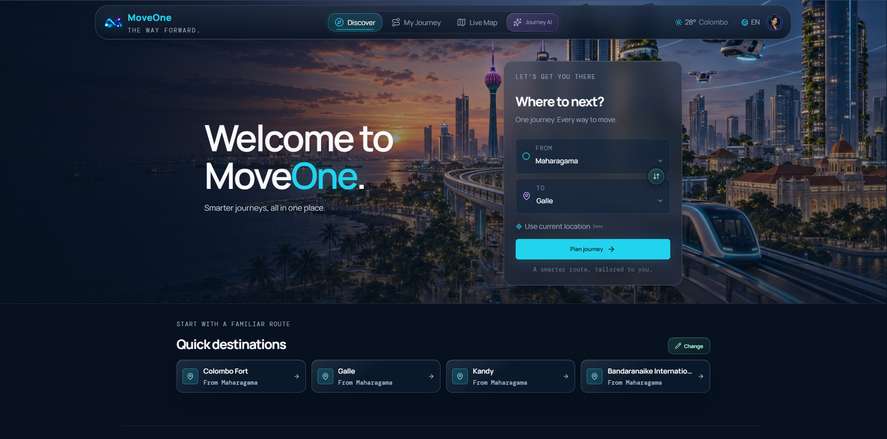
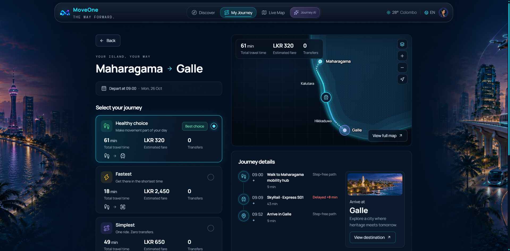
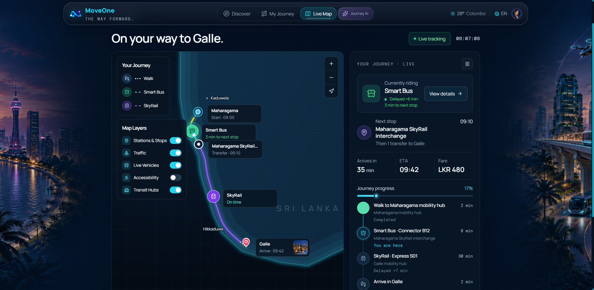
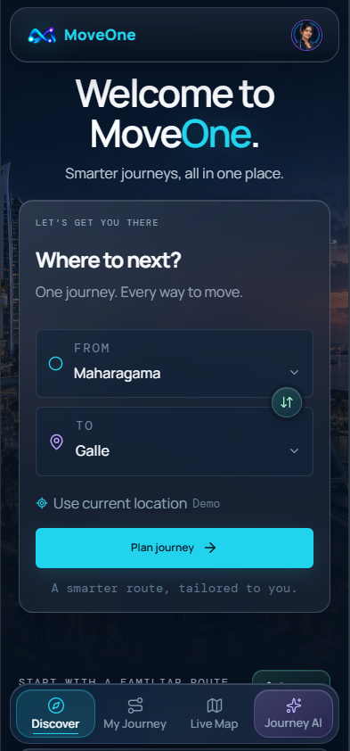
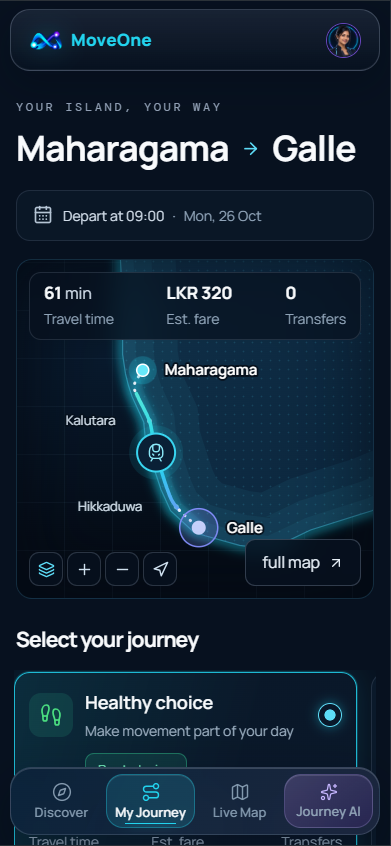
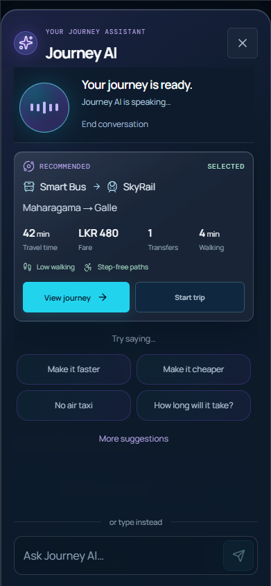
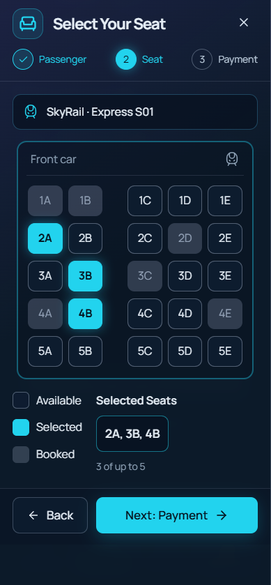
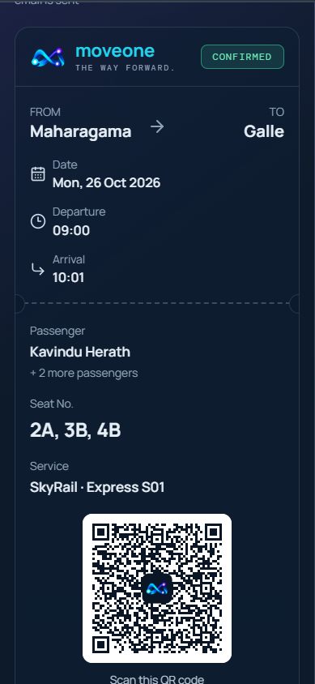
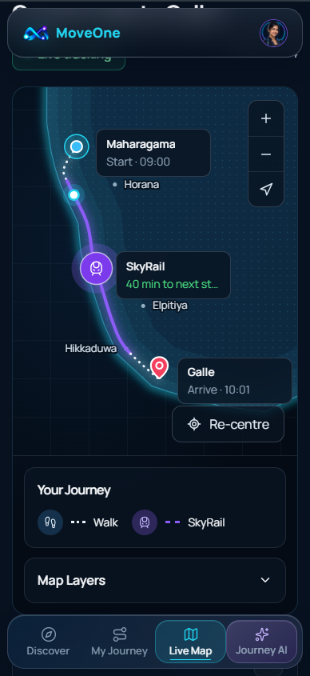

<div align="center">

# MOVEONE
### Transportation in 2100 · Sri Lanka, Reimagined

**One connected experience for tomorrow's journeys.**

A responsive, installable smart-mobility web app concept created by **Team PixelCraft** for **Cre8X 3.0 — The Oracle Challenge (Round 01)**.

[**Explore the Live Demo**](https://transport-2100-ashy.vercel.app/) · [**View the Source Code**](https://github.com/PixelCraft-Cre8X/transport-2100)

   

</div>

## Overview

MOVEONE imagines how people could plan and manage travel across Sri Lanka in the year **2100**. It combines futuristic transport modes—**Autonomous SkyRail, Smart Bus, Air Taxi, and Smart Road infrastructure**—into a single, accessible journey experience.

Instead of switching between disconnected services, users can discover destinations, compare possible routes, try a guided booking flow, and follow a simulated journey. The interface is designed with clear navigation, responsive layouts, and accessibility-minded travel preferences.

> **Concept disclaimer:** MOVEONE is a **frontend-only competition prototype**, not a real transportation, ticketing, or payments service. Routes, vehicle positions, prices, availability, and status updates are illustrative/simulated; no real payments are processed.

## Explore the Experience

| Discover | Your Journey | Live Tracking |
| --- | --- | --- |
| Find destinations and explore future mobility options. | Compare routes, transport segments, fares, and accessibility preferences. | Follow simulated trip progress, transfers, and journey alerts. |
| `/` | `/journey` | `/tracking` |

### Key Features

- **Multimodal journey planning:** explore connected journeys across SkyRail, Smart Bus, Air Taxi, and walking segments supported by smart-road concepts.
- **Route comparison:** review alternatives based on journey time, estimated fare, transfers, comfort, walking, and other available route preferences.
- **Journey AI preview:** use typed requests and, in supported browsers with microphone permission, a voice-based travel assistant. Its route logic uses local language rules and predefined demo journey data—not a hosted generative-AI model.
- **Accessibility-minded UI:** low-walking and step-free route indicators, readable content, and both voice and text interaction paths.
- **Demo booking flow:** enter sample passenger information, select seats, complete a simulated payment step, and generate a sample QR ticket.
- **Simulated live tracking:** view an illustrative route map, trip progress, transfer timeline, notifications, and journey sharing.
- **Responsive PWA:** installable web app experience with a manifest, service worker, and limited app-shell caching for supported browsers.

## Screenshots

The screenshots below show the desktop and mobile experience. Image files should be added to the indicated paths before publishing this README.

### Desktop

**Discover — home page**



| Journey comparison | Simulated live tracking |
| :---: | :---: |
|  |  |

### Mobile

| Discover | Journey comparison | Journey AI |
| :---: | :---: | :---: |
|  |  |  |

| Booking flow | QR ticket | Live tracking |
| :---: | :---: | :---: |
|  |  |  |

## Built With

- **React 19** — component-based frontend.
- **Vite 8** — development server and production build.
- **React Router** — Discover, Journey, and Tracking routes.
- **CSS** — responsive layouts, futuristic visual styling, and interface details.
- **Lucide React** — UI iconography.
- **qrcode-generator** — sample booking-ticket QR codes.
- **Web APIs** — Web Speech API (where available), Web App Manifest, service worker, and browser session storage.
- **Mapbox GL / optional Mapbox geocoding helper** — dependency and optional integration path; the showcased route visuals and movement are simulated rather than a live transport feed.
- **Vercel** — frontend deployment.

## Getting Started

### Prerequisites

Install a recent Node.js release and npm compatible with Vite 8.

### Run locally

```bash
git clone https://github.com/PixelCraft-Cre8X/transport-2100.git
cd transport-2100/cre8x-transport-2100
npm ci
npm run dev
```

Open the local address printed by Vite (usually `http://localhost:5173`).

### Checks and production preview

```bash
npm run lint
node --test tests/*.test.mjs
npm run build
npm run preview
```

### Optional Mapbox configuration

The prototype can be explored **without a Mapbox token**. For the optional geocoding integration, create `cre8x-transport-2100/.env.local`:

```env
VITE_MAPBOX_ACCESS_TOKEN=your_public_mapbox_token
```

Use only a suitably restricted **public** Mapbox token in frontend code. Never put secret or server-side credentials in `VITE_` variables: Vite bundles these values into client-side assets.

## PWA Notes

MOVEONE includes a web app manifest, install icons, and a service worker. On a supported browser, you may install it using the browser's **Install app** or **Add to Home Screen** option.

Caching provides a limited app-shell/navigation fallback; **complete offline functionality, live travel updates, and real-world navigation are not guaranteed**. Voice input relies on browser support, permissions, and sometimes an online recognition service.

## Project Structure

```text
transport-2100/
├── README.md                   # Repository overview (this file)
├── .gitignore                  # Root-level ignore rules
├── docs/
│   └── screenshots/
│       ├── desktop/
│       └── mobile/
└── cre8x-transport-2100/       # Vite + React application
    ├── public/                 # PWA manifest, icons, service worker
    ├── src/
    │   ├── components/         # Reusable UI, planner, map, booking
    │   ├── data/               # Demo network, routes, booking data
    │   ├── pages/              # Discover, Journey, Tracking
    │   └── utils/              # Booking, voice, and journey helpers
    ├── tests/                  # Project tests
    └── package.json
```

## Team PixelCraft

Created collaboratively by four undergraduate team members for Cre8X 3.0:

- **K. Dineth Dovindu** — UI development, PWA implementation, and Vercel deployment.
- **G. R. Dilshani Kaushalya Bandara** — team contributor.
- **P. M. Buhuni Levanya Dayananda** — team contributor.
- **M. D. G. U. Jayalal** — team contributor.

The project is the result of shared team effort. Individual responsibilities can be expanded here with each member's approval.

## Competition Context

**Cre8X 3.0 · Round 01: The Oracle Challenge**  
**Theme:** Transportation 2100  
**Team:** PixelCraft  
**Project:** MOVEONE

The prototype explores an inclusive digital interface for futuristic transportation, bringing route discovery, journey management, smart mobility, and simulated updates into one cohesive experience.

## Important Notes

- There is **no production backend**, real transport-system integration, live GPS/vehicle feed, or real payment processing.
- Journey AI is based on predefined destinations and local intent-processing logic. Its voice features vary by browser.
- Payment and seat-selection interactions are demonstrations. **Do not enter real payment-card details.**
- Screenshots should use sample passenger data only. Confirm permission to publish any third-party artwork and other licensed assets.

---

<div align="center">

Made by **Team PixelCraft** for **Cre8X 3.0 — The Oracle Challenge**.

[Live Demo](https://transport-2100-ashy.vercel.app/) · [GitHub Repository](https://github.com/PixelCraft-Cre8X/transport-2100)

</div>
